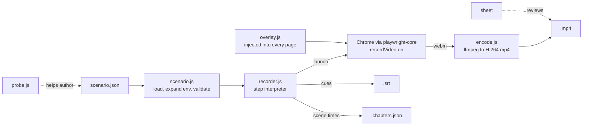

# Architecture

Showrunner is a small pipeline: **scenario file -> validated plan -> scripted browser with video on -> webm -> mp4 (+ subtitles, chapters)**.
About 500 lines of ESM, two dependencies.

## Modules

| File | Responsibility | I/O |
|---|---|---|
| `src/scenario.js` | Parse JSON, expand `${env:...}`, validate every step with a path in the error, resolve `baseUrl`, build SRT text | reads one file |
| `src/overlay.js` | Runs **inside the page**: captions, title cards, cursor, click ripple | DOM only |
| `src/recorder.js` | Launches Chrome, interprets steps, tracks chapters and caption cues, finalises the video | browser, writes outputs |
| `src/encode.js` | Finds ffmpeg, builds argument lists (pure), runs it | spawns ffmpeg |
| `src/probe.js` | Lists targetable elements on a live page | browser |
| `bin/showrunner.mjs` | Argument parsing and the commands | CLI |

Pure logic (validation, URL resolution, SRT, ffmpeg arguments) is separated from I/O so it is unit-tested without a browser.

## How recording works

1. A **browser context** is created with `recordVideo` at the viewport size. Playwright encodes frames to a `.webm` as the page paints.
2. `overlayInit` is registered with `addInitScript`, so the overlay exists on **every navigation** without the scenario doing anything. It is one fixed, `pointer-events: none` element, so it cannot intercept clicks or change layout.
3. The recorder walks `scenes[].steps[]`. Each step maps to one entry in an `actions` table. The action is looked up through the fixed `ACTIONS` list, never by an arbitrary key on the step.
4. Closing the context **flushes** the video; its path is then read and the file renamed to `<name>.webm`.
5. If ffmpeg is available the webm is re-encoded to **H.264 / yuv420p / faststart**, which is what browsers, QuickTime, Slack and GitHub expect. The raw webm is kept.

### The cursor

Headless Chrome has no visible pointer, so a viewer would see UI changing by itself. The overlay draws an SVG arrow and moves it on `mousemove`, and a ring animation on `mousedown`. The recorder moves the *real* mouse in many small steps (`page.mouse.move(..., {steps})`), which both triggers hover states in the app and gives the overlay cursor a smooth path. The last position is kept in `sessionStorage`, so the cursor does not jump back to the corner after a page load.

### Time

`pace` multiplies every wait and hold. `--fast` multiplies by a further 0.25 and shortens glides and typing, which turns a 3-minute take into about 45 seconds: long enough to exercise every selector, short enough to iterate. Chapters and subtitle cues are timestamped from the moment the page is created, so they track the video to within a fraction of a second.

### Failure model

| Situation | Behaviour |
|---|---|
| Step fails (selector missing, not visible, timeout) | Logged, **rest of that scene abandoned**, next scene still records. Reported at the end; `--strict` turns it into exit code 1 |
| Step marked `"optional": true` | Logged and skipped, scene continues |
| Scenario is invalid | Nothing launches; every problem is listed with its path (`scenes[2].steps[1]: ...`) |
| Missing `${env:X}` | Error. It is never substituted with an empty string |
| Chrome cannot start | Error naming the fix (`executablePath`, `showrunner doctor`) |
| ffmpeg not found | The `.webm` is kept and a warning is printed |

Per-action `timeout` defaults to 8 s rather than Playwright's 30 s. One wrong selector should cost seconds, not stall the take.

## Security notes

- **Scenarios are data, not code.** There is no `eval`, no JS hook and no shell step in a scenario. A scenario can only navigate, click, type, press keys, scroll, wait and set `localStorage`.
- **Caption and card text is inserted as escaped text**, never as HTML. A scenario (or copy pasted from an untrusted page) cannot inject markup into the page being recorded. This is covered by a test that mutation-checks the escaping.
- **Secrets stay out of files.** Tokens go through `${env:NAME}`.
- **You are driving a real browser with your session data.** Point it at staging or local environments, and at throwaway accounts, never at production with real customer data on screen. A video is a public artefact the moment it is shared.

## Decisions and trade-offs

| Decision | Why | Cost |
|---|---|---|
| Declarative JSON, not a JS API | Reviewable in a PR, safe to accept from others, trivially validated | No loops or conditionals; use `optional` and generate JSON if you need logic |
| Role/name targets over CSS | Reads like the demo script, survives restyling | Needs accessible names in the app (which is also good for the app) |
| Real Chrome (`channel: chrome`) | Real fonts and rendering, no browser download | Chrome must be installed; Chromium via `executablePath` otherwise |
| DOM overlay, not post-production | One command, no editor; captions are also exported as subtitles | OS-native popups are not captured |
| Real-time recording | Exactly what a user would see, including animations | Take length equals video length |
| Re-encode to H.264 | Universal playback | A second pass; the original webm is kept |
| Abandon scene on failure | A half-run scene shows a wrong state; later scenes are independent | A single typo hides the rest of that scene until you fix it |

## Extending

- **New action:** add the name to `ACTIONS` in `scenario.js`, a validation rule beside the others, and a function in the `actions` table in `recorder.js`. Add a test.
- **Different look:** edit the CSS in `overlay.js` (it is one template string). It must stay self-contained: the function is serialised into the page.
- **Other output formats:** `mp4Args` in `encode.js` is the only place ffmpeg arguments are built.
